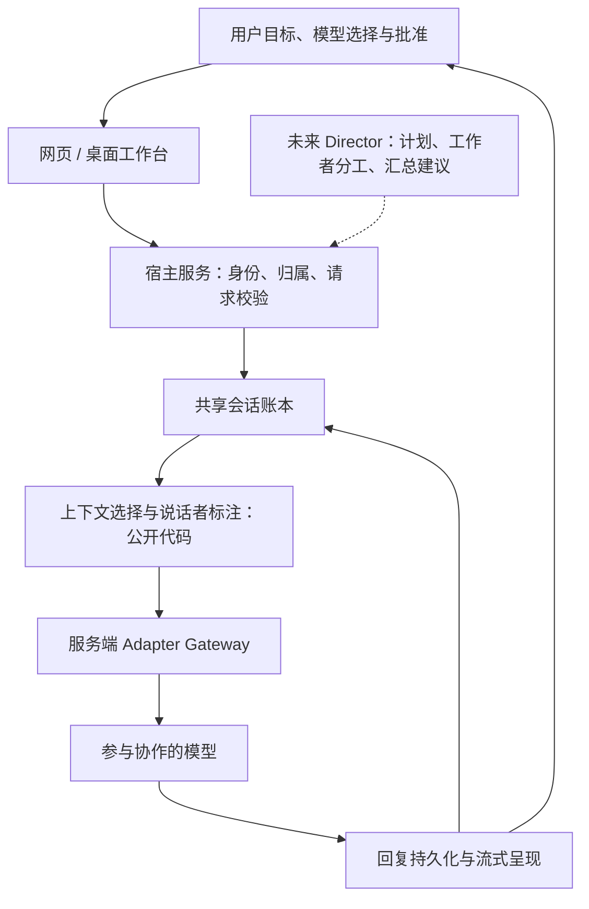

# AstraRelay · 多模型协作工作台

把多个模型放进同一个任务空间，让它们接续工作，而不是让人反复搬运上下文。

AstraRelay 是我的个人全职探索项目，从多模型群聊与记忆原型演进为网页和 Windows 桌面协作工作台。这个公开仓库是面向技术交流与面试的精选展示：包含架构说明，以及从实际项目原样选出的共享上下文代码与测试；它不是完整应用源码或可部署产品。真实开发持续保留在私有仓库，不公开账户、支付、模型接入实现、业务数据及原始开发历史。

建议阅读顺序：[项目问题与个人工作](#项目问题与个人工作) → [架构与边界](#架构与边界) → [代码走读](#代码走读共享上下文) → [测试](#运行公开样例测试) → [深入设计说明](docs/architecture.md)。

## 项目问题与个人工作

使用多个模型时，我遇到的核心问题不是“能否再接一个聊天 API”，而是协作状态丢失：需求在一个窗口、修改理由在另一个窗口、新加入的模型不知道前面的约束。用户既要比较模型输出，又要充当上下文搬运工和结果整理者。

因此，项目把“会话记录”进一步视为协作账本：用户需求、模型回复和已有阶段摘要进入同一条可回溯的记录；每次模型请求从中构造所需上下文。模型可以分工，但不各自维护一套互不相通的角色记忆。用户始终决定谁参与、共享什么，以及下一步是否执行。

作为个人项目，我围绕以下部分持续设计、实现和验证，并使用 AI 辅助开发、检查与迭代；工程判断、权限边界和验收仍由我负责：

- 产品与交互：从群聊原型转向任务协作工作台，设计会话、模型选择、上下文模式与模型能力提示。
- 后端协作链路：共享账本、上下文组织、模型适配接口、流式回复，以及会话归属和写入边界。
- 网页与桌面衔接：Flask 网页工作台、Electron 桌面外壳、云端会话同步与受控本地项目交互。
- 工程质量：针对性回归测试、兼容旧接口、发布净化策略，以及对自动化通过和真实验收的区分。

我更关注“为什么这样组织协作、哪里不能自动化、怎样证明没有破坏边界”，而不只展示模型返回了一段文本。

## 当前进展：实现、摘录与方向

| 领域 | 私有项目已有开发基础 | 本仓库可直接检查的内容 | 尚未交付的方向 |
| --- | --- | --- | --- |
| 协作上下文 | 共享会话账本、上下文模式、中途加入模型的上下文同步 | `CollaborationContextService` 与三项回归测试 | 严格 token 预算、摘要质量评估、冲突与证据追踪 |
| 模型接入 | 服务端适配、模型目录、能力分类与多模型回复 | 接口与信任边界说明 | 能力/成本/可用性联合路由策略 |
| 网页工作台 | 账户与找回、会话管理、模型选择、附件、SSE 流式输出、公开模型信息页 | 产品与架构说明 | UI 一致性、错误恢复和部署基线完善 |
| Windows 桌面 | Electron 外壳、云端会话同步、本地项目编辑阶段与打包验证 | 桌面权限分层说明 | 完整人工验收、签名与更新、高权限能力逐项批准 |
| 商业基础 | 开发期积分账本、预冻结/结算/回滚骨架、支付适配与模拟流程 | 风险和边界说明 | 真实公众收费、提现、商业运营与合规审查 |
| 自动编排 | 多模型协作与共享上下文基础 | orchestrator-worker 设计讨论 | 自治 Director、通用 Agent 执行、跨业务 Memory、企业多租户 |

这里的“已有基础”不等于生产服务认证。网页和桌面体验仍在迭代，商业化尚未完成；本仓库不提供完整应用启动、账号演示或安装包。

## 架构与边界

### 从共享任务到 orchestrator-worker

编排者—工作者（orchestrator-worker）是演进方向：编排层做相对轻量的意图判断、任务拆分、上下文选择与结果整合；专门的工作者承担分析、核对、写作或代码等有明确输入输出的步骤。这里的“轻量”描述职责划分，不是已测得的延迟或开销指标，也不把某个模型永久绑定为主脑。



实线描述项目的协作链路；虚线 Director 是未来工作。当前代码不代表完整自治规划、并行调度、工具执行、失败补偿或自我验证已经实现。模型提出建议不等于获得操作权限，人仍可调整模型、改变上下文范围、审阅结果并决定后续动作。

### Adapter Gateway：统一接口，不泄露接入细节

私有实现保留兼容接口 `AIAdapter.reply_with_history(message, history, model="deepseek")`，返回纯文本。这里的默认值来自历史兼容，不意味着新会话自动选择模型，也不是永久指定某个协作角色。网关是架构边界，不是本仓库新增的服务。

调用方应传入当前消息、已经过归属检查的历史和明确的模型标识；服务端负责模型目录、可调用状态、模态能力、超时及错误归一化。真实连接与凭据只存在服务端部署环境中。公开交互只呈现公共模型名称与能力，不下发凭据或私有传输标识。

目录收录不等于当前部署可调用；模型支持文本也不意味着支持图片或文件。当能力不匹配时，应解释限制并建议可处理该模态的辅助模型，不把不兼容请求伪装成成功。SSE 是交互呈现通道，也不能替代持久化、授权或结算成功的判定。

## 代码走读：共享上下文

公开实现位于 [collaboration_context.py](collaboration_context.py)，测试位于 [tests/test_collaboration_context.py](tests/test_collaboration_context.py)。它是一个只依赖注入数据库对象的上下文工具，没有网络客户端，不创建账户，不读取配置，也不调用模型。

### 1. 从同一账本取得历史

`build(conversation_id, model_id, mode="smart", message_ids=None)` 调用 `database.get_shared_messages(conversation_id, limit=None)`。输入是当前会话的共享消息序列，输出为空列表，或一条形如 `{"role": "system", "content": "当前协作上下文：…"}` 的消息。

它不按目标模型过滤其他模型的回复，所以中途加入的模型能够看到此前的共同讨论。`model_id` 在 `build` 中不参与筛选；它不是访问控制参数，也没有被用作独立记忆分区。

### 2. 按用户选择组织历史

| 模式 | 实际代码行为 | 需要理解的边界 |
| --- | --- | --- |
| `smart`（默认） | 保留所有已有 `summary`，再保留最后 `history_limit` 条非摘要消息，按原记录顺序输出 | 默认 `history_limit=24`；限制消息条数，不限制每条长度，也不限制摘要总数 |
| `full` | 使用宿主返回的全部共享历史 | 随会话增长，请求体与模型上下文压力可能持续增加 |
| `from_now` | 直接返回 `[]`，不查询历史 | 本次构造不带旧历史；不是建立一个持久的“从此时起”时间游标 |
| `custom` | 仅选择 `message_ids` 中的记录 | 无匹配或未选择时为空；归属校验不能交给 ID 集合本身 |

这个样例不生成摘要、不执行 tokenizer、不实施严格 token 上限，也不证明压缩率或成本节省。`smart` 只是“已有摘要 + 最近消息”的选择策略：摘要越来越多或单条内容很长时，输出仍可很大；过往细节也可能被省略。若宿主需要严格预算，应另行估算、截断或拒绝，并明确告知丢失的内容。

### 3. 保留说话者来源

`_format_message` 把用户内容标为“用户”，把已知模型标为公共名称；未知模型回退到记录内的 `model`，缺失时使用“协作模型”。这样接手的模型能分辨“谁说了什么”，但这些标签不是可信指令等级。

尤其要注意：样例把拼接的历史放进一条 system 消息，这有便于兼容的好处，也存在历史文本被当作高优先级指令的风险。宿主应把历史视为不可信数据，考虑保留角色结构、加引用边界和做提示注入评估。未知 `model` 的原值也可能不适合公开展示，调用方必须先做安全标签映射；工具本身没有完成公开元数据净化。

### 4. 单独记录同步确认

`mark_synced(conversation_id, model_id, message_id)` 只委托 `mark_model_context_synced` 更新确认位置，不自动调用 `build`，不验证模型真的理解了历史，也不保证请求成功或重试幂等。宿主决定何时确认；测试证明它只传递指定模型和消息位置，不修改其他模型游标。

数据库接口、消息字段、所有权前置条件和异常状态见 [深入设计说明](docs/architecture.md)。

## 关键工程取舍与失败模式

- **共享账本优先于独立人格记忆。** 同一目标与约束更容易同步，但错误结论也会传播。阶段摘要、来源标记和人工复核不可省略；多模型一致不等于事实正确。
- **纯工具优先于绑定数据库。** 注入两个小接口使合成测试无需 MySQL，也便于宿主替换存储；代价是排序、ID 唯一性、租户隔离和事务一致性必须在外部契约中落实。
- **先可解释选择，再追求自动压缩。** `smart` 很容易观察和测试，但它目前会读取全部历史，再在内存中筛选；长会话需要数据库侧窗口查询、摘要生命周期与严格预算，不能把此实现称为大规模性能优化。
- **确认游标不等于恰好一次执行。** 模型失败、SSE 中断、重试和响应落库失败可能出现在不同阶段；生产设计需要请求 ID、状态机和幂等控制，不能凭一个同步标记防止重复调用或重复扣费。
- **桌面能力分层开放。** 私有桌面采用渲染层沙箱和受控主进程云端边界；本地项目能力不能自然扩大为终端、补丁、Git、Skills 或完整访问权限。未来每一类能力都需要独立授权与审计。
- **兼容性比一次重写重要。** 保留旧适配接口与既有提及解析边界，增量改造可降低联动风险；代价是需要明确历史默认值与新产品规则之间的区别。

## 运行公开样例测试

本仓库只需要 Python 3.9+ 和 pytest，无需模型账户、API Key、数据库、Node.js 或运行中的服务。在独立虚拟环境中，从公开仓库根目录执行：

```sh
python -m venv .venv
# Windows PowerShell
.venv\Scripts\python.exe -m pip install pytest
.venv\Scripts\python.exe -m pytest -q tests/test_collaboration_context.py
# macOS / Linux 使用 .venv/bin/python 执行相同命令
```

公开样例的可复现预期为 **3 passed**：

1. 新加入模型收到此前用户和其他模型的共享历史。
2. 同步确认只委托更新指定模型的游标。
3. 四种上下文模式返回对应的选取结果。

这些测试使用 `FakeCollaborationDatabase` 和合成消息，不访问真实网络或存储。它们证明小范围选择、格式化和委托契约，不证明完整应用、鉴权、摘要质量、token 预算或并发安全。边界值、异常输入和故障注入是值得继续补充的测试方向，不能仅凭三个用例宣称覆盖完备。

私有开发中还维护 Python、网页 JavaScript 与桌面测试。历史记录中的通过数量属于特定日期、分支和环境，不是本仓库附带的测试或本次公开验证结果，因此这里以可运行的三项样例为直接证据。

## 安全与信任边界

上下文工具不做登录、会话所有权、租户过滤或 CSRF 校验。宿主必须先验证用户拥有当前会话，再读取共享历史；不能把客户端给出的 `conversation_id` 直接视为授权。自定义消息也必须局限在该会话内，未来多租户必须在查询和写入两端同时隔离。

所有模型凭据由服务端环境注入，不添加浏览器端密钥输入或储存流程。公开页面、JSON、日志与报错不应暴露私有接入信息；提示词、附件和用户内容应避免进入日志。用户内容、工具输出和模型回复均不是系统授权依据。

支付与积分只存在开发期骨架与模拟验证；没有开放真实公众充值、收费或提现。正式运营还需要支付主体、隐私、条款、内容治理、数据导出删除与部署安全审查。桌面自动化和 Agent 执行也不能绕过人的显式批准。

## 个人背景与实践规模

这是我的个人全职探索，驱动力来自自己长期使用多个模型完成任务时的协作痛点。我希望通过这个项目展示从产品问题出发，落到服务边界、状态管理、可测代码和可解释发布流程的工程思考。

作者自述：内部项目实践中曾出现**单日峰值超过 100M tokens（1 亿 tokens）**的用量。该数据未经第三方审计，统计口径与原始计量不在公开仓库中验证；它不是日均值，不是并发、吞吐、延迟或性能基准，也不能作为生产稳定性、真实租户数量或商业收入的证明。

## 路线图：从协作工作台到 AI Team OS

1. **上下文质量与可靠性**：建立严格预算、摘要来源与版本、故障状态和评估样本；优先让错误和信息丢失可见。
2. **可审阅的编排层**：逐步分离 Director 的计划建议、Agent 的受控执行、Memory 的长期信息治理，以及 Model Router 的能力/成本/可用性策略；不把这四者混为一个拥有全部权限的模型。
3. **多租户 SaaS 基础**：补齐租户隔离、成员与角色权限、配额、审计、数据生命周期与运维；现有多用户账户不等于已实现企业多租户。
4. **有条件的商业化**：在独立审查和真实验收后评估部署、签名更新、正规支付和商业运营。没有承诺固定交付日期或已经具备服务等级保障。

## 维护与公开同步策略

私有仓库继续承载真实开发；公开仓库是人工维护的精选快照，不做自动镜像或自动私转公同步。每次更新都重新选择范围、运行测试、扫描敏感内容与私有标记，并由维护者检查最终文件清单后明确批准发布。公开贡献应限于展示文档、样例与测试；不能据此推断未公开模块的实现状态。

公开内容固定为本 README、[架构文档](docs/architecture.md)、`.gitignore`、[上下文实现](collaboration_context.py) 与[上下文测试](tests/test_collaboration_context.py)。没有应用入口、安装清单、真实集成、私有历史或业务数据。请勿提交真实对话、凭据、联系方式或账户记录；安全问题请先请求维护者的私密联系渠道，再提供脱敏复现。

## 面试与技术交流：可以继续追问什么

- [上下文选择实现](collaboration_context.py)：为什么保留所有摘要？如何避免摘要持续膨胀，又保留原始证据？
- [数据库与归属契约](docs/architecture.md#数据与归属契约)：如何把共享会话扩展到租户隔离，并防止对象 ID 越权？
- [同步确认测试](tests/test_collaboration_context.py)：什么时候推进游标？重试、部分失败和幂等边界如何定义？
- [可信与不可信内容](docs/architecture.md#上下文不是授权)：为什么把历史放进 system 消息有风险？如何改成结构化角色与引用数据？
- [网关兼容契约](docs/architecture.md#adapter-gateway-兼容契约)：如何保留纯文本旧接口，同时支持流式事件、结构化使用量和统一错误？
- [未来职责拆分](docs/architecture.md#演进职责与人类控制)：Director 提出计划后，谁能真正授权 Agent 执行，谁负责预算与取消？
