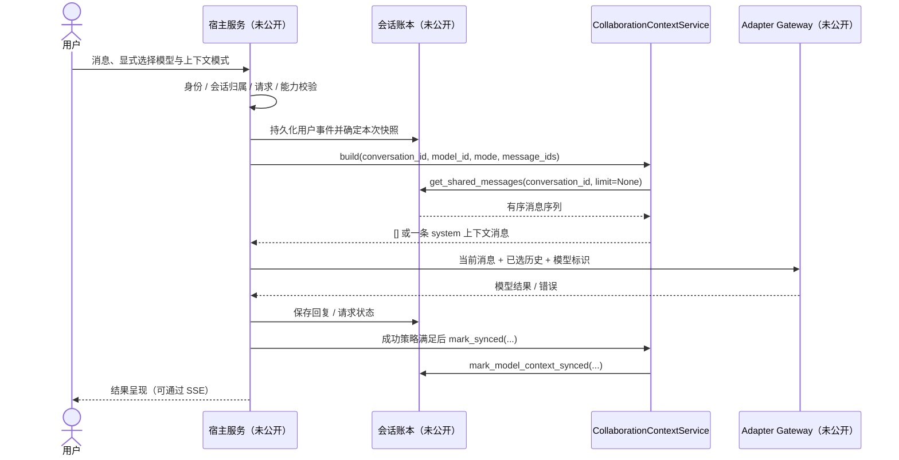

# AstraRelay：共享上下文与服务边界

本文是 [项目 README](../README.md) 的深入补充，区分可运行的上下文摘录、私有宿主责任和未来设计。公开源文件只有 [collaboration_context.py](../collaboration_context.py) 与[对应测试](../tests/test_collaboration_context.py)，本文中的 Protocol/DTO 是接口说明，不是新增的生产业务实现。

## 当前样例的执行流



图中只有 Context 的筛选、格式化和同步委托是公开代码。事件持久化时机、快照一致性、模型请求、SSE 与事务状态由宿主负责；图示是集成职责描述，不证明所有阶段已具备原子事务。`from_now` 在读取账本之前直接返回空上下文。

## 数据与归属契约

### 注入的数据库 Protocol

公开类依赖以下鸭子类型接口，不依赖具体数据库驱动：

```python
# 说明性接口；不是仓库新增的可执行 Protocol 类。
get_shared_messages(conversation_id, limit=None) -> list[dict]
mark_model_context_synced(conversation_id, model_id, message_id) -> None
```

`get_shared_messages` 应返回该会话中按时间/事件顺序排列的消息。`limit=None` 在当前样例中意味着读取全部记录。算法保留输入顺序，不自行排序；若宿主返回乱序记录，“最近 N 条”的含义就不可靠。

宿主必须先完成身份认证与会话所有权检查，并在存储查询中约束会话归属。将来多租户还必须同时绑定租户和用户授权范围。工具没有当前用户参数，没有鉴权上下文，不能单独承担这些检查，也不能防止使用他人的会话 ID。`custom` 仅在返回的当前会话消息内选 ID，但前提仍是数据库只返回已授权记录。

### 消息 DTO

| 字段 | 当前用途 | 宿主应保证的前置条件 |
| --- | --- | --- |
| `id` | `smart` 与 `custom` 的选择集合、同步位置 | 会话内稳定、唯一、可哈希；缺失或重复会使选择扩大或混淆 |
| `role` | 判断是否标注为“用户” | 使用约定角色；当前格式化器仅专门区分 `user` |
| `content` | 拼接为上下文文本 | 应校验类型和长度，避免把敏感数据和不必要附件原文直接拼入 |
| `model` | 显示说话者名称 | 已知别名用公共名称；未知值会原样回退，不能传入私有接入标识 |
| `message_type` | 等于 `summary` 时视为已有摘要 | 摘要由宿主产生并治理；样例不检验其正确性、来源或时效 |

输出 DTO 为 `[]`，或只有一个元素的 `[{"role": "system", "content": "当前协作上下文：\\n..."}]`。它不是模型响应，不携带 token 数量、成本、租户信息、版本或请求状态。调用方需要自行组装当前请求，避免重复加入已在账本中的同一用户消息。

`history_limit` 默认 24，当前构造器不做参数校验。正整数是预期用法，但 `0` 在 Python 切片 `[-0:]` 中实际会保留全部非摘要消息，负数也有切片语义；不能把它们当成安全限额。宿主应校验配置，后续若改变工具行为应先补边界回归测试。

## 四种选择与中途加入

`smart` 先收集所有摘要，再取最后 N 条非摘要消息，将两者的 ID 合并成集合，最后遍历原历史，按原顺序保留匹配记录。它不会改写原始账本，不调用摘要模型，也不限制摘要数量、总字符数或 token 总量。时间复杂度为 O(n)，所读历史与选择集合也需要 O(n) 级空间；最终拼接还取决于内容总长度。

`full` 不筛选；`custom` 按传入 ID 集合筛选；`from_now` 不读取历史且不建立持久起点。无历史、无自定义匹配记录时返回空列表，不生成假摘要。非法 mode 抛出 `ValueError`。

新的参与模型调用同一 `build`，会收到当前模式选出的共同历史，而不是只看到自己的输出；`model_id` 不参与历史筛选。同步确认是另一条独立接口：`mark_synced` 只把三个参数转交数据库。它不按游标增量读取，不负责已读状态判断，更不证明远端模型理解了历史。

## Adapter Gateway 兼容契约

私有项目保留接口：

```python
AIAdapter.reply_with_history(message, history, model="deepseek")
# 返回：纯文本 str
```

该接口和纯文本结果是旧调用方兼容边界。默认模型值不改变“新会话无默认选择”的产品规则：交互层必须在发送前要求用户明确选模型。现有兼容提及解析和模型集合生成也不应借接口文档整理而改变。

网关输入的 `history` 应来自宿主批准的上下文，模型标识应经过可调用目录和能力校验；连接配置与凭据只从服务端环境获取。网关应隐藏传输差异，提供安全错误分类，不把原始异常、请求提示词或凭据带入公开响应。

公开工具不实现此网关，也不导入其客户端。未来需要流式事件、使用量、结构化结果时，可以设计独立的新契约或兼容包装层，而不悄悄把旧接口返回值从字符串改成迭代器或对象。SSE 转发层负责事件类型和内容边界；纯文本旧接口与流式能力不是一回事。

## 校验、失败与恢复责任

| 情况 | 样例当前表现 | 宿主的处理责任 |
| --- | --- | --- |
| 不支持的 context mode | `ValueError` | 校验请求并返回安全错误，不泄露堆栈 |
| 空历史 / 自定义 ID 无匹配 | 返回 `[]` | 明确说明本次共享范围，不伪造前情 |
| 账本读取或同步写入失败 | 异常直接向调用方传播 | 安全分类、状态记录、适当重试，不吞错为成功 |
| 模型超时、能力不符或不可调用 | 不在工具职责内 | 提示限制或兼容模型；明确失败状态与重试权限 |
| SSE 中断 / 用户关闭页面 | 不在工具职责内 | 区分传输中断与任务终态，避免重复保存/调用/计费 |
| 请求期间又有新消息 | 无快照版本或锁 | 明确事件上界和一致性策略，不能假设每次读取相同 |
| 同步确认重复 / 乱序 | 原样委托 | 定义单调推进、幂等请求 ID、事务与补偿边界 |

发布的三项测试只验证正常选择与委托，未覆盖表中所有异常。未来测试应加入空历史、非法模式、重复/缺失 ID、超长文本、摘要膨胀、数据库异常与并发快照；这些是改进清单，不是已实现的可靠性保证。

## 上下文不是授权

说话者标签提供来源线索，但内容仍可能带有提示注入、错误结论或过时约束。当前把全部历史放在一条 system 消息中的做法，可能模糊“用户数据”与“系统指令”的边界。集成时需考虑角色保持、引用分隔、来源追踪和不可信内容测试；不能把历史中的“请执行命令”直接变成工具权限。

共享记录也不应天然包含所有信息。账户资料、其他租户消息、凭据、支付信息和无关附件必须留在授权范围之外。摘要不是脱敏器，截断也不是隐私控制。访问审计应记录必要的安全元数据，而不是原样记录提示词和秘密。

桌面主进程与渲染层、服务器与模型连接分别构成不同信任边界。本地项目权限不等于 Shell、Git 推送或发布授权；任何未来 Agent 都必须遵守用户选择的授权范围，支持审阅与取消，不因“完成任务”自动扩大权限。

## 演进职责与人类控制

以下是 AI Team OS 的职责方向，不是当前已集成的独立服务：

| 组件 | 应负责 | 不应隐含获得的权限 |
| --- | --- | --- |
| Director | 理解目标、提出计划与分工、建议上下文、整合结果 | 自动批准敏感动作、绕过用户选择 |
| Agent | 在有界任务与工具许可内执行、报告结果与失败 | 任意读取项目/账户资料、无限重试或自主发布 |
| Memory | 信息来源、版本、保留/删除、授权范围和质量治理 | 将所有历史永久共享给所有任务或租户 |
| Model Router | 能力、成本、可用性与策略匹配 | 绕过预算或把未知模型当作具备任意模态能力 |
| 宿主服务与用户 | 身份、授权、预算、审计、批准与取消 | 不能把责任转交给模型文本或 UI 展示状态 |

先建设可观察、可解释的请求状态，再逐项引入自动编排。结果正确性需要证据与复核，多模型交叉回答不保证独立，也不自动形成事实共识。未来 SaaS 还须独立验证租户隔离、配额、审计、数据生命周期和部署安全，不能用已有账户系统或开发期支付模拟代替。

回到 [README](../README.md) 查看项目背景、样例运行方式与公开同步政策。
